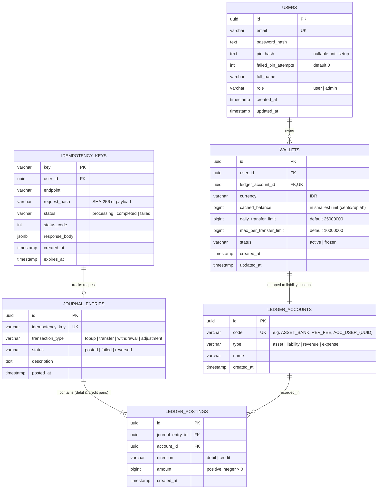
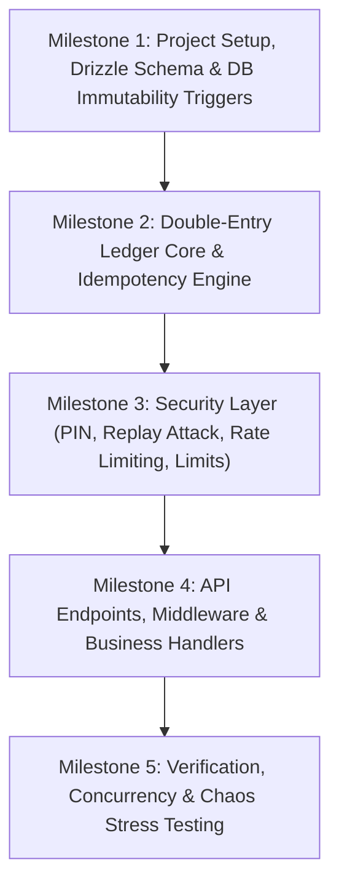

# Product Requirements Document (PRD)
## Drizzle Wallet & Ledger API Service (`drizzle-wallet-api`)

* **Status:** Approved for MVP
* **Target Release:** MVP Phase 1
* **Stack:** Bun, TypeScript, Hono, Drizzle ORM, PostgreSQL, Zod

---

## 1. Executive Summary & Problem Statement

### 1.1 Background
Dalam sistem finansial, dompet digital (*digital wallet*), atau *payment gateway*, integritas data dan keamanan adalah prioritas absolut. Kesalahan seperti *double spending*, saldo negatif akibat *race condition* (request bersamaan), modifikasi riwayat transaksi secara ilegal, atau kebocoran dana akibat pengambilalihan akun dapat menyebabkan kerugian finansial yang fatal.

### 1.2 Objective
Membangun backend API layanan dompet digital (*Digital Wallet & Ledger Service*) kelas produksi yang menerapkan standar industri perbankan:
* **Double-Entry Bookkeeping** (pembukuan berpasangan).
* **Pessimistic Locking** (`SELECT ... FOR UPDATE`) untuk pencegahan *race condition* saldo.
* **Idempotency Key Engine** untuk pencegahan mutasi ganda akibat *network retry*.
* **Defense-in-Depth Security**: *Second-Factor Transaction PIN*, pembatasan limit transaksi, proteksi *replay attack*, *rate-limiting*, dan *Zero-Trust Database Immutability* (tabel ledger bersifat *append-only* murni).

---

## 2. Core User Personas & Roles

| Role | Deskripsi | Hak Akses |
| :--- | :--- | :--- |
| **User (Customer)** | Pemilik akun wallet individual | - Registrasi, Login (JWT), Setup 6-digit PIN<br>- Melihat saldo & riwayat mutasi wallet miliknya<br>- Eksekusi Top-Up, Transfer P2P (wajib PIN), dan Penarikan Dana |
| **Admin / Auditor** | Operator sistem & auditor finansial | - Memantau seluruh akun sistem (Kas Utama, Akun Pendapatan/Fee)<br>- Memeriksa jejak audit seluruh *journal entries* & *postings*<br>- Membekukan atau mengaktifkan kembali wallet pengguna (*freeze/unfreeze*) |

---

## 3. Technology Stack & Architectural Decision Records (ADR)

* **Runtime:** [Bun](https://bun.sh/) (Performa tinggi, native TypeScript support, fast UUIDv7 generator).
* **Web Framework:** [Hono](https://hono.dev/) (Minimal overhead, type-safe router, native middleware support).
* **Database & ORM:** PostgreSQL + [Drizzle ORM](https://orm.drizzle.team/) (Type-safe SQL queries, transaction control, schema migration via `drizzle-kit`).
* **Validation:** Zod via `@hono/zod-validator` (Validasi ketat pada request body, headers, dan query params).
* **Authentication & Cryptography:** 
  * JWT (`hono/jwt`) dengan access token masa berlaku pendek (15–60 menit).
  * Argon2id / Bcrypt untuk hashing password login dan 6-digit Transaction PIN.
  * SHA-256 untuk *request body hashing* pada validasi idempotency.
* **Security & Reliability:**
  * Header `Idempotency-Key` bertipe UUIDv7.
  * Header `X-Timestamp` untuk mitigasi *Replay Attack*.
  * In-memory / Redis sliding window rate-limiting.
  * PostgreSQL Trigger untuk menegakkan prinsip *append-only* (mencegah `UPDATE` dan `DELETE` pada tabel ledger).

---

## 4. Double-Entry Bookkeeping & Accounting Principles

Layanan ini mengadopsi standar akuntansi formal: **Total Debit = Total Credit**.
Setiap mutasi finansial menghasilkan 1 *Journal Entry* yang membawahi minimal 2 baris *Postings*.

### 4.1 Tipe Akun Ledger
1. **Asset (`asset`):** Akun kas atau settlement riil (misal: `ASSET_CASH_SETTLEMENT`). Bertambah di sisi **Debit**, berkurang di sisi **Credit**.
2. **Liability (`liability`):** Akun saldo milik pengguna (karena saldo user adalah kewajiban sistem kepada user). Bertambah di sisi **Credit**, berkurang di sisi **Debit**.
3. **Revenue (`revenue`):** Akun pendapatan sistem dari biaya transaksi/admin (misal: `REVENUE_PLATFORM_FEE`). Bertambah di sisi **Credit**.

### 4.2 Contoh Ilustrasi Transaksi

#### A. Top-Up Saldo (Contoh: User A top-up Rp 100.000)
* **Debit:** `ASSET_CASH_SETTLEMENT` (+ Rp 100.000)
* **Credit:** `LIABILITY_USER_A` (+ Rp 100.000)

#### B. P2P Transfer dengan Biaya Admin (Contoh: Transfer Rp 50.000 + Biaya Rp 1.000)
* **Debit:** `LIABILITY_USER_A` (- Rp 51.000)
* **Credit:** `LIABILITY_USER_B` (+ Rp 50.000)
* **Credit:** `REVENUE_PLATFORM_FEE` (+ Rp 1.000)
* *Verifikasi Invariant:* Total Debit (51.000) == Total Credit (50.000 + 1.000).

#### C. Withdrawal / Payout (Contoh: User A menarik Rp 30.000)
* **Debit:** `LIABILITY_USER_A` (- Rp 30.000)
* **Credit:** `ASSET_CASH_SETTLEMENT` (- Rp 30.000)

---

## 5. Entity Relationship Diagram & Database Schema



### 5.1 Aturan, Integritas Data & Database Hardening
1. **Representasi Uang (`amount` & `cached_balance`):** Wajib menggunakan `bigint` (satuan terkecil, misalnya Rupiah bulat atau Cents) untuk mencegah *floating-point precision loss*.
2. **Postings Non-Negatif:** Nilai `amount` pada `ledger_postings` harus selalu positif (`amount > 0`). Arah pergerakan saldo ditentukan murni oleh kolom `direction` (`debit` atau `credit`).
3. **Atomic Transaction:** Semua operasi jurnal dan posting wajib dieksekusi di dalam Drizzle `db.transaction(async (tx) => { ... })`.
4. **Database-Level Immutability (Append-Only Trigger):**
   Pada level PostgreSQL, dibuat *trigger rule* yang **menolak keras operasi `UPDATE` dan `DELETE`** pada tabel `journal_entries` dan `ledger_postings`. Sekalipun terjadi celah aplikasi, riwayat buku besar mustahil diubah atau dihapus.
5. **Anti-Integer Overflow:** Skema Zod membatasi input nominal maksimal tidak melebihi batas aman `BIGINT` PostgreSQL.

---

## 6. Functional Requirements (Fitur MVP)

### 6.1 Autentikasi & Akun Pengguna
* **FR-AUTH-01:** Pengguna dapat mendaftar dengan email, nama lengkap, dan password yang di-hash dengan aman.
* **FR-AUTH-02:** Saat pendaftaran berhasil, sistem otomatis membuatkan 1 `ledger_accounts` (tipe `liability`) dan 1 `wallets` terkait.
* **FR-AUTH-03:** Login mengembalikan JWT Bearer Token yang menyimpan `userId` dan `role` (`user` atau `admin`).
* **FR-AUTH-04 (Setup & Ganti PIN):** Pengguna wajib mengatur 6-digit angka PIN transaksi sebelum dapat mengeksekusi transfer atau withdrawal.

### 6.2 Operasi Transaksi Finansial
* **FR-TX-01 (Top-Up):** Pengguna dapat menambah saldo ke wallet-nya. Saldo berpindah dari `ASSET_CASH_SETTLEMENT` ke akun liability pengguna.
* **FR-TX-02 (P2P Transfer):** Pengguna dapat mentransfer dana ke pengguna lain dengan memvalidasi kepemilikan dana, status wallet tujuan, dan verifikasi PIN transaksi pengirim.
* **FR-TX-03 (Transaction Fee):** Setiap transfer dikenakan biaya admin tetap (misal Rp 1.000) yang dialokasikan ke akun `REVENUE_PLATFORM_FEE`.
* **FR-TX-04 (Withdrawal):** Pengguna dapat menarik dana keluar sistem (saldo liability berkurang bersamaan dengan pengurangan kas settlement).
* **FR-TX-05 (Wallet Invariant & Freezing):** Saldo wallet pengguna tidak boleh bernilai negatif pada setiap mutasi debit. Jika status wallet `frozen`, semua transaksi keluar ditolak.

### 6.3 Concurrency Control & Pessimistic Locking
* **FR-CONC-01:** Sebelum memotong saldo, query Drizzle wajib melakukan lock baris wallet pengguna pengirim:
  ```typescript
  const [lockedWallet] = await tx
    .select()
    .from(wallets)
    .where(eq(wallets.id, walletId))
    .for("update");
  ```
* **FR-CONC-02:** Menjamin transaksi paralel (misalnya 2 transfer keluar bersamaan) dieksekusi secara serial sehingga saldo tidak dapat dihabiskan melebihi batas (*anti-double spending*).

### 6.4 Idempotency Key Engine
* **FR-IDEM-01:** Header HTTP `Idempotency-Key` wajib disertakan pada semua endpoint mutasi finansial (`POST /transactions/*`).
* **FR-IDEM-02:** Menyimpan `request_hash` (SHA-256 dari request body). Jika request datang dengan `Idempotency-Key` sama tetapi body berbeda, tolak dengan `422 Unprocessable Entity`.
* **FR-IDEM-03:** Jika request dengan kunci yang sama masih berstatus `processing`, kembalikan HTTP `409 Conflict`.
* **FR-IDEM-04:** Jika request dengan kunci yang sama sudah `completed`, kembalikan respons tersimpan (*cached payload & status code*) tanpa mengulang mutasi ledger.
* **FR-IDEM-05:** Kunci idempotency memiliki waktu kedaluwarsa (TTL 24 jam).

---

## 7. Security & Abuse Prevention Specifications

### 7.1 Second-Factor Transaction PIN & Brute-Force Lock
* **SEC-PIN-01 (Header Verifikasi):** Seluruh mutasi dana keluar (`transfer`, `withdraw`) wajib menyertakan header `X-Transaction-PIN`.
* **SEC-PIN-02 (PIN Hashing):** PIN 6 digit disimpan dalam bentuk hash (Argon2id/Bcrypt) pada kolom `users.pin_hash`.
* **SEC-PIN-03 (Auto-Freeze on Brute-Force):** 
  * Jika pengguna salah memasukkan PIN, counter `failed_pin_attempts` bertambah +1.
  * Jika `failed_pin_attempts >= 5`, sistem otomatis mengubah status `wallets.status = 'frozen'` dan menolak seluruh transaksi hingga dibuka manual oleh Admin/Verifikasi Identitas.
  * Jika PIN benar, counter direset kembali ke 0.

### 7.2 Transaction Limits (Mitigasi Risiko Kebocoran Akun)
* **SEC-LIM-01 (Per-Transaction Limit):** Setiap transaksi transfer keluar dibatasi maksimal (misal: Rp 10.000.000 / transaksi).
* **SEC-LIM-02 (Daily Cumulative Limit):** Sistem menghitung total mutasi keluar dalam 24 jam terakhir. Jika total melebihi `daily_transfer_limit` (default Rp 25.000.000), transaksi ditolak dengan error `400 Daily Limit Exceeded`.

### 7.3 Request Integrity & Replay Attack Defense
* **SEC-NET-01 (Timestamp Window):** Client wajib mengirimkan header `X-Timestamp` (format ISO-8601 atau Unix milliseconds).
* **SEC-NET-02:** Server memvalidasi bahwa selisih waktu request terhadap waktu server tidak boleh lebih dari $\pm 300\text{ detik}$ (5 menit). Request yang melampaui batas ini langsung dibatalkan (*Replay Protection*).

### 7.4 Rate Limiting
* **SEC-RAT-01 (Auth Endpoints):** `POST /api/v1/auth/login` dibatasi maksimal **5 request / menit** per alamat IP untuk mencegah *credential stuffing*.
* **SEC-RAT-02 (Transaction Endpoints):** `POST /api/v1/transactions/*` dibatasi maksimal **15 request / menit** per User ID.

### 7.5 Sensitive Data Masking & Log Sanitization
* **SEC-LOG-01:** Middleware logging dilarang keras mencatat field berikut ke stdout/file log:
  * `password`, `pin`, header `Authorization`, header `X-Transaction-PIN`.
* **SEC-LOG-02:** Error response ke client tidak boleh membocorkan detail query SQL, stack trace, atau schema internal.

---

## 8. API Specification (RESTful)

### 8.1 Authentication & Security Endpoints
* `POST /api/v1/auth/register` - Pendaftaran user baru & auto-create wallet liability.
* `POST /api/v1/auth/login` - Otentikasi & penerbitan JWT token (Rate limit: 5 req/min).
* `GET /api/v1/auth/me` - Informasi profil pengguna yang sedang login.
* `POST /api/v1/auth/pin/setup` - Mengatur atau memperbarui 6-digit transaction PIN.
  * Headers: `Authorization: Bearer <JWT>`
  * Body: `{ "pin": "123456" }`

### 8.2 Wallet & Balance Endpoints
* `GET /api/v1/wallets/me` - Menampilkan detail wallet, status (`active`/`frozen`), dan saldo saat ini.
* `GET /api/v1/wallets/history` - Menampilkan daftar riwayat mutasi transaksi beserta arah (debit/kredit).

### 8.3 Transaction Endpoints
Seluruh endpoint mutasi finansial **wajib** menyertakan headers:
* `Authorization: Bearer <JWT>`
* `Idempotency-Key: <UUIDv7>`
* `X-Timestamp: <ISO-8601>`
* `X-Transaction-PIN: <6-digits>` *(Wajib untuk transfer & withdraw)*

* `POST /api/v1/transactions/topup`
  * Body: `{ "amount": 100000, "source": "BANK_TRANSFER" }`
* `POST /api/v1/transactions/transfer`
  * Body: `{ "recipientWalletId": "uuid", "amount": 50000, "note": "Bayar kopi" }`
* `POST /api/v1/transactions/withdraw`
  * Body: `{ "amount": 25000, "bankAccount": "BCA - 123456789" }`

### 8.4 Admin & Audit Endpoints (Admin Role Only)
* `GET /api/v1/admin/ledger/accounts` - Rekapitulasi seluruh akun buku besar (Asset, Liability, Revenue).
* `GET /api/v1/admin/ledger/audit` - Verifikasi integritas: memeriksa apakah $\sum \text{debit} == \sum \text{credit}$ di seluruh sistem.
* `PATCH /api/v1/admin/wallets/:id/status` - Membekukan (`frozen`) atau mengaktifkan kembali (`active`) wallet pengguna (misal setelah unfreeze PIN).

---

## 9. Non-Functional Requirements (NFR)

1. **Konsistensi Data (ACID):** Tidak ada transaksi parsial yang ter-commit jika terjadi error jaringan atau constraint violation.
2. **Kinerja:** Waktu respons API rata-rata $\le 100\text{ ms}$ untuk transfer standar di bawah kondisi beban normal.
3. **Type Safety End-to-End:** Validasi input schema Zod selaras dengan schema definisi Drizzle ORM.
4. **Auditability & Non-Repudiation:** Tidak ada data posting yang boleh dihapus atau dimanipulasi secara fisik (*Strict Append-Only Database Triggers*).

---

## 10. Implementation Roadmap



1. **Milestone 1: Project Setup, Drizzle Schema & DB Triggers**
   * Inisialisasi Bun + Hono + Drizzle.
   * Konfigurasi Docker Compose PostgreSQL lokal.
   * Pembuatan schema (`users` dengan PIN & counter, `wallets` dengan limits, `ledger_accounts`, `journal_entries`, `ledger_postings`, `idempotency_keys`).
   * Pemasangan SQL Trigger PostgreSQL untuk memblokir `UPDATE` & `DELETE` pada tabel ledger.
   * Migrasi skema menggunakan `drizzle-kit`.

2. **Milestone 2: Double-Entry Core & Idempotency Engine**
   * Pembuatan modul `LedgerEngine` dengan method atomic: `recordEntry()`.
   * Implementasi validasi balance invariant ($\text{Debit} - \text{Credit} = 0$).
   * Implementasi *Pessimistic Lock* (`for("update")`).
   * Middleware Idempotency Key dengan hashing payload SHA-256.

3. **Milestone 3: Security & Guard Layer**
   * Endpoint Setup PIN & logic hashing Argon2/Bcrypt.
   * Middleware verifikasi `X-Transaction-PIN` dengan mekanisme *auto-freeze* pada 5x kesalahan.
   * Middleware Replay Protection (`X-Timestamp` validation window $\pm 300\text{ detik}$).
   * Validasi limit transaksi (maks per-transfer & akumulasi 24 jam).
   * Rate limiting pada route auth dan mutasi.

4. **Milestone 4: API Endpoints & Business Logic**
   * Implementasi lengkap route Auth, Wallet, Transfer, Top-up, Withdrawal, dan Admin Audit.
   * Sanitasi response & log masking middleware.

5. **Milestone 5: Concurrency & Chaos Stress Testing**
   * Unit test: Double-entry invariant, pemotongan fee, skenario PIN benar/salah.
   * Concurrency test: Mengirimkan 10–20 request transfer paralel serentak melampaui saldo (memastikan lock bekerja sempurna dan tidak terjadi saldo negatif).
   * Replay & idempotency test: Mengirimkan request ganda dengan key sama.
